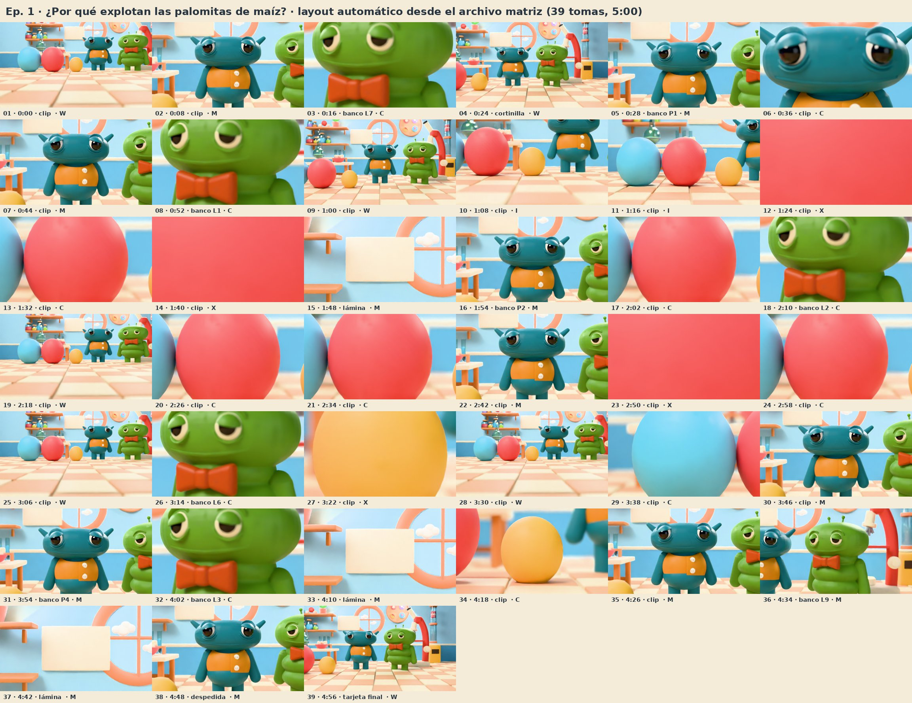

# Los 52 episodios en 3D · plan de producción

Este plan produce en 3D **los 52 episodios del archivo matriz**: 5:00 cada uno, en cuatro temporadas de 13 y con el plan anual de la guía. No se recorta la serie. Lo que cambia según el equipo es cuánto se tarda.

## 1. Lo que pide el archivo matriz, en cifras

Datos sacados de `src/` con [`matriz/exportar.mjs`](matriz/exportar.mjs).

| | Año completo | Por episodio |
| --- | --- | --- |
| Piezas | 2.028 | 39: 34 clips de 8 s y 5 láminas, 5:00 exactos (comprobado en los 52) |
| Clips con personaje | 316 | 6,1 |
| Clips solo con objetos y fenómenos | 913 | 17,6 |
| Reacciones del banco (P1-P10, L1-L10) | 487 | 9,4 |
| Láminas | 156, más 52 cortinillas y 52 tarjetas finales | 3 + 2 |
| Objetos nuevos | 196 | 3,8 |
| Protagonista | Pipo 26, Plop 26 | alterna |

**Lo que dicen estas cifras:**
- **Solo el 18 % de las piezas lleva actuación de personaje.** Son 316 de 1.768 clips.
- **Casi la mitad son objetos y fenómenos.** Esas tomas se resuelven con simulación y una biblioteca reutilizable.
- **Un tercio se anima una sola vez para todo el año.** Son las 487 reacciones del banco, más las 52 cortinillas, tarjetas finales y despedidas.

### Las seis zonas del laboratorio

| Zona | Episodios | Objetos |
| --- | --- | --- |
| Cuerpo | 13 | 48 |
| Animales | 10 | 37 |
| Cocina | 9 | 33 |
| Cosas de casa | 9 | 34 |
| Tierra y espacio | 6 | 24 |
| Cielo y clima | 5 | 20 |

**Cada temporada usa las seis zonas**, así que las seis tienen que existir antes de estrenar, aunque sea en una versión básica. Las zonas con un solo episodio en una temporada pueden empezar como telón de plastilina sobre el set, la regla que ya tiene la guía.

## 2. La idea: lo que se repite se hace una vez

En la producción con IA cada clip se generaba desde cero. En 3D, todo lo que se repite se construye una vez en la preproducción, y cada episodio se monta encima.

| Se hace una vez | Cubre |
| --- | --- |
| Pipo y Plop definitivos, con esqueleto sencillo y 9 bocas cada uno | los 52 |
| El laboratorio: zona central y seis zonas | los 52 |
| Biblioteca de acciones: las 20 reacciones del banco, la cortinilla, la tarjeta final y las despedidas | unas 640 piezas del año (32 %) |
| Biblioteca de fenómenos, en orden de uso | la mayoría de los 913 clips de objetos |
| Plantilla de episodio: [`blender/episodio.py`](blender/episodio.py) monta las 39 tomas desde el archivo matriz en 15 segundos | los 52 |
| Sonido: narración en 5 idiomas, efectos y mezclas, con las herramientas que ya existen | los 52 |

**Biblioteca de fenómenos.** El orden sale de contar en las acciones del archivo matriz los clips sin personaje (conteo aproximado por palabras clave):

| Fenómeno | Clips | Episodios |
| --- | --- | --- |
| Flotar, volar, ir a la deriva | 178 | 47 |
| Bolitas y partículas (también las del zoom) | 140 | 36 |
| Luz que se enciende o brilla | 88 | 34 |
| Crecer, brotar, subir | 86 | 36 |
| Gotas | 54 | 18 |
| Inflar y desinflar (globos para pulmones, etc.) | 51 | 22 |
| Temblar o vibrar | 50 | 27 |
| Caer y rebotar | 39 | 21 |
| Burbujas | 35 | 9 |
| Estallar, romperse | 34 | 18 |
| Vapor de plastilina | 34 | 20 |
| Girar | 30 | 18 |
| Chispa o señal que viaja (la que sube a la cabeza) | 20 | 12 |

Con los cuatro primeros, más de la mitad de las tomas de objetos ya tiene base.

**Layout automático.** [`blender/episodio.py`](blender/episodio.py) lee el episodio del archivo matriz y monta la escena:
- el laboratorio;
- Pipo y Plop, el protagonista al centro;
- los objetos como maquetas a su tamaño real;
- una cámara por toma según su código (W, M, C, X, T, I);
- un marcador en el segundo exacto de cada toma, para que Blender cambie de cámara solo;
- en cada cámara, la nota de qué se ve, la acción y la frase del narrador.

Este es el Ep. 1 montado así, sin tocar nada a mano:

## 3. Trabajo por episodio

Es una estimación para una persona con práctica, con las bibliotecas ya hechas. **El piloto la mide de verdad** y con esa cifra se fija el calendario.

| Tarea | Qué incluye | Días-persona |
| --- | --- | --- |
| Layout | `episodio.py` monta las 39 tomas; se ajustan cámaras y posiciones | 1 |
| Animación de personajes | Los 6 clips con personaje más las interacciones que ahora permite el 3D: unos 60-90 s a dos | 5-7 |
| Banco y rituales | Colocar las acciones ya animadas (9,4 reacciones, cortinilla, tarjeta y despedida) | 1 |
| Objetos y fenómenos | 17,6 clips, unos 140 s, ajustando la biblioteca en vez de animar desde cero | 4-5 |
| Objetos nuevos | 3,8 piezas de plastilina por episodio | 2-3 |
| Luz y render | Plantilla de luz por zona; el render (EEVEE) va de noche | 1 |
| Montaje y sonido | Narración en 5 idiomas, efectos y mezclas | 2 |
| **Total** | | **16-20**, unas 3-4 semanas de una persona |

Los 52 suman **unos 830-1.040 días-persona**, más una preproducción de unos 4 meses.

## 4. Cuántas personas para los 52

| Ritmo | Los 52 terminados en | Equipo |
| --- | --- | --- |
| **Uno por semana, como el archivo matriz** | unos 16 meses: 4 de preproducción y 12 de producción | 4-5 personas: tú en dirección, guion y montaje, y 3-4 en animación y objetos |
| **Una temporada de 13 cada 4-5 meses** | unos 22 meses | 3 personas |
| **Tú solo** | unos 4-5 años | 1 |

En los tres casos se hacen los 52 episodios. El calendario de publicación sigue el del archivo matriz. Conviene estrenar cuando haya colchón, por ejemplo 8 episodios terminados, para que el ritmo semanal no dependa de la semana de producción.

## 5. Orden de producción: por zonas, no por número

Dentro de cada temporada se producen juntos los episodios de la misma zona: el set, la luz y los objetos ya están montados. Se publican en el orden del archivo matriz, que nunca repite categoría dos semanas seguidas.

| Temporada | Producción por zonas | Objetos nuevos |
| --- | --- | --- |
| 1 | Cocina (1, 3, 6, 11) → Casa (2, 5, 9) → Cuerpo (4, 8, 12) → Animales (10) → Cielo (7) → Tierra (13) | 52 |
| 2 | Cocina (20, 25) → Casa (17, 23) → Cuerpo (14, 18, 24) → Animales (16, 22) → Cielo (15, 21) → Tierra (19, 26) | 55 |
| 3 | Cocina (33, 37) → Casa (27, 31) → Cuerpo (30, 34, 38) → Animales (28, 32, 36) → Cielo (29) → Tierra (35, 39) | 49 |
| 4 | Cocina (51) → Casa (43, 47) → Cuerpo (40, 46, 49, 52) → Animales (42, 44, 48, 50) → Cielo (45) → Tierra (41) | 40 |

## 6. Calendario

| Etapa | Qué sale | Duración |
| --- | --- | --- |
| Preproducción |  | unos 4 meses |
| ↳ personajes | Pipo y Plop definitivos: esculpidos sobre las maquetas, con esqueleto y 9 bocas | dentro de la preproducción |
| ↳ sets | Zona central y seis zonas, al menos en versión básica | dentro de la preproducción |
| ↳ bibliotecas | Las 20 reacciones del banco, los rituales y los fenómenos más usados | dentro de la preproducción |
| ↳ piloto | **Ep. 1 en 3D** sobre su narración en 5 idiomas, que ya existe; aquí se mide el ritmo real | dentro de la preproducción |
| Colchón | Episodios 2 a 8, en orden de zonas | según el equipo |
| Temporadas 1 a 4 | 13 episodios cada una, publicación semanal | según el equipo (sección 4) |

**Los episodios 1 a 4 que ya están hechos con IA** tienen guion, narración en 5 idiomas y efectos. Ese sonido sigue el esqueleto de 5:00, así que sirve tal cual para sus versiones 3D si se respetan los tiempos de cada toma. Hay dos opciones:
- publicarlos ya para abrir el canal mientras se produce el 3D;
- guardarlos y estrenar la serie entera en 3D.

## 7. Seguimiento

[`matriz/plan_52.csv`](matriz/plan_52.csv) tiene una fila por episodio con:
- temporada, zona y protagonista;
- clips con personaje y de objetos, reacciones, láminas y objetos nuevos;
- columnas de seguimiento: layout, animación, render, mezcla en 5 idiomas y publicado.

Se abre en Excel o en Google Sheets. Si cambia el archivo matriz, `node 3d/matriz/exportar.mjs` lo regenera y **conserva lo que ya hayas marcado** en las columnas de seguimiento.
