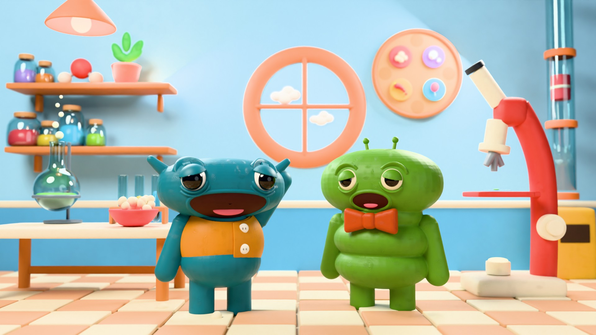
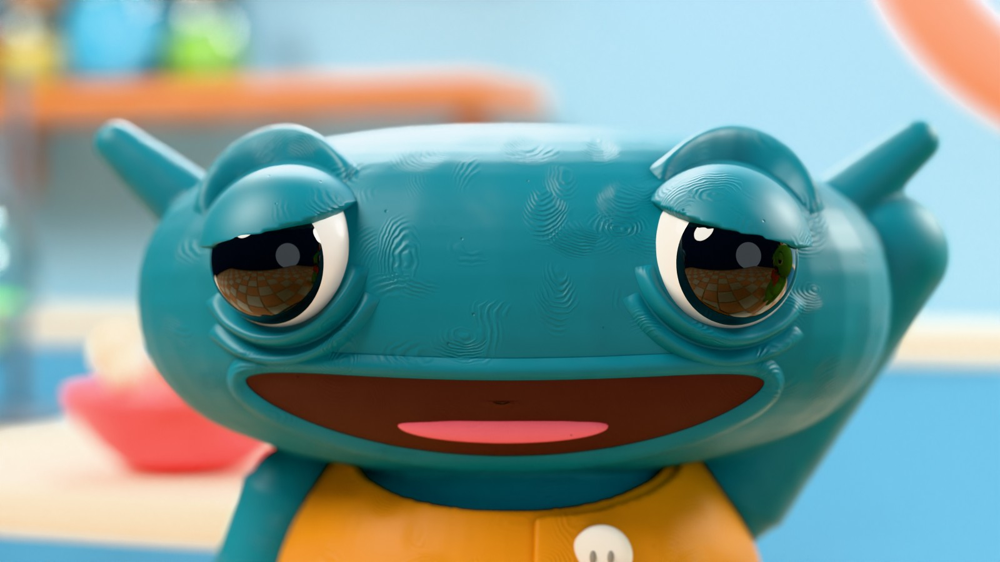
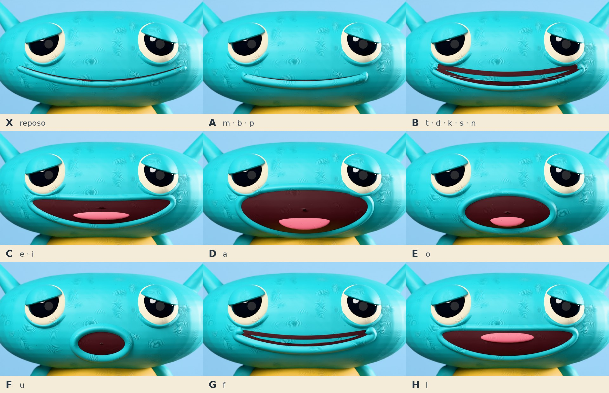

# Pipo y Plop en 3D · evaluación y plan



*Primer fotograma del proyecto en 3D. Lo hizo el kit de esta carpeta, sin IA y sin créditos: Pipo y Plop en la misma toma, Pipo hablando (boca D) y Plop sorprendido (boca E). Detrás se ven la ventana, los estantes, el microscopio del zoom, el tubo de las preguntas y el muro con las insignias de los episodios 1 a 4. Se renderizó con la CPU de un servidor; en tu RTX 5060 Ti tarda una fracción de ese tiempo.*

> **La ciencia con Pipo y Plop.** Dos criaturas de plastilina, Pipo, el de las ideas locas, y Plop, una criatura microscópica parecida a un tardígrado, resuelven cada semana un misterio cotidiano en su laboratorio. No hablan ningún idioma humano: hablan con los sonidos de la ciencia. Por eso se entienden en todo el mundo.

## 1. Veredicto

**Sí. Es el paso correcto y es el momento de darlo.** La producción con IA llegó a su techo:
- un solo personaje por toma;
- un fondo liso;
- bocas cerradas;
- clips de 8 segundos con una sola acción;
- tamaños que el modelo confunde;
- créditos que se gastan en cada intento.

En 3D, cada una de esas reglas desaparece. Además, el gasto cambia de forma: deja de ser un coste por clip y pasa a ser una inversión en piezas que se reutilizan (personajes, set, bocas, acciones). Cada episodio sale más barato que el anterior. Con un plan de 52 episodios, la cuenta favorece al 3D.

Hay tres condiciones. Si no se cumplen, el proyecto se atasca:

1. **El cuello de botella será animar, no renderizar.** Tu PC renderiza de sobra; lo que cuesta son las horas de animación. El ritmo de un episodio por semana estaba pensado para generar con IA. En 3D, una sola persona hace al principio un episodio cada 4 a 6 semanas. Ver la [sección 6](#6-lo-que-hay-que-saber-antes-riesgos-y-cómo-evitarlos).
2. **Antes de producir episodios, una pieza de muestra.** Unos 60 a 90 segundos con calidad final. Es lo que se enseña a las empresas y lo que mide tu ritmo real.
3. **Amplía la RAM a 32 GB.** Es la mejora más barata y la que más se nota.

## 2. Lo que gana el proyecto

| Hoy, con IA | En 3D |
| --- | --- |
| Pipo y Plop nunca en la misma toma | Juntos, interactuando, reaccionando en vivo: el dúo cómico que el formato pedía |
| Un fondo liso azul para todo el canal | Un laboratorio con zonas, profundidad y luz que cambia |
| Boca cerrada todo el episodio | Hablan su propio idioma con 9 bocas de reemplazo |
| Clips de 8 s con una sola acción | Tomas de cualquier duración: el experimento dura lo que tenga que durar |
| El tamaño de los objetos se escribe en cada prompt y aun así falla | Escala real: el matraz mide lo que mide, siempre |
| Rasgos y colores que varían entre clips | El mismo modelo en cada fotograma |
| Créditos por intento y repeticiones | Coste fijo: tu PC y tu tiempo |
| Para un formato vertical hay que regenerar | Para un formato vertical se añade una cámara |
| La ciencia queda a merced del modelo («alucina») | Lo que se ve lo decides tú: simulaciones con física real |

## 3. Tu PC: lo que puede y lo que no

**CyberPowerPC GXiVR8040A19**
- **Procesador:** Intel Core i7-14700F (20 núcleos, 28 hilos, hasta 5,4 GHz).
- **Memoria:** 16 GB DDR5.
- **Tarjeta gráfica:** GeForce RTX 5060 Ti de 8 GB.
- **Disco:** SSD NVMe Gen4 de 1 TB.
- **Sistema:** Windows 11 Home.

**Puntos fuertes**
- **La RTX 5060 Ti renderiza muy bien en Blender.** Tiene núcleos RT para OptiX y su puntuación estimada en Blender ronda los 4.300 puntos ([Renderjuice, a partir de Blender Open Data](https://www.renderjuice.com/gpus/rtx-5060-ti-for-blender)). Rinde al nivel de las GPU que Colab suele asignar o por encima: [una T4 da unos 1.800 puntos](https://opendata.blender.org/benchmarks/5615bf27-17da-4ea5-9a36-1fb32e65e631/), y en Cycles las tarjetas de consumo suelen superar a las de centro de datos como la A100 ([SaladCloud](https://blog.salad.com/blender-rendering-benchmark)).
- **Los 20 núcleos del procesador** sirven para simulaciones (fluidos, cuerpos rígidos, partículas), que en Blender van por CPU, y para exportar video.
- **El estilo plastilina es agradecido.** Formas simples, materiales mate y planos fijos se renderizan rápido. No hay pelo, ni tela, ni miles de personajes.

**Límites y qué hacer con ellos**

| Límite | Qué hacer |
| --- | --- |
| **16 GB de RAM.** Blender, DaVinci Resolve y el navegador a la vez lo llenan. | Ampliar a **32 GB** (2 × 16 GB DDR5 iguales). Mira antes cuántas ranuras tiene la placa. |
| **8 GB de memoria gráfica.** Es poca para escenas muy pesadas en Cycles y para modelos de IA de video. | Texturas de 2K como máximo; los materiales del kit son procedurales y casi no ocupan memoria. La IA pesada, en la nube y solo cuando haga falta (sección 4). |
| **1 TB de disco.** Las secuencias de imágenes lo llenan rápido. | Un segundo SSD de 2 TB para renders y un disco externo para copias. |
| Los Core de 13.ª y 14.ª generación tuvieron un problema de inestabilidad. | **Actualiza la BIOS** a la última versión del fabricante, que trae el microcódigo de Intel que lo corrige. |
| Controlador de la tarjeta. | Instala el **NVIDIA Studio Driver**, el pensado para Blender y Resolve, en lugar del Game Ready. |

**¿Cuánto tarda un episodio en renderizarse?** Animado a dos, un episodio de 5:00 tiene unas 3.600 poses distintas (300 s × 12). Para medirlo en tu equipo ejecuta [`blender/benchmark.py`](blender/benchmark.py): renderiza el plano del laboratorio en EEVEE y en Cycles y te da las horas por episodio.

Orden de magnitud esperado, pendiente de confirmar con la prueba:
- **EEVEE:** de 3 a 15 s por fotograma, unas pocas horas por episodio.
- **Cycles:** de 20 a 90 s por fotograma, entre una noche y un fin de semana.

Las dos cifras son asumibles. Lo que de verdad lleva tiempo es animar.

## 4. Google Colab Pro+: no para renderizar

**No lo contrates para empezar.**
- **Precio y unidades:** Colab Pro+ cuesta 49,99 USD al mes por unas 600 unidades de cómputo; algunas fuentes dicen 500.
- **GPU:** no garantiza cuál te toca (T4, L4 o A100).
- **Sesiones:** se cortan, con un máximo de 24 h en segundo plano.
- **Caducidad:** las unidades caducan a los 90 días ([resumen de precios 2026](https://www.thundercompute.com/blog/colab-alternatives-for-cheap-deep-learning-in-2025)).
- **Consumo:** el gasto por hora lo miden terceros y cambia. En marzo de 2026 se midieron 1,19 unidades/h con una T4, 1,71 con una L4 y 5,40 con una A100 ([McCormick](https://mccormickml.com/2024/04/23/colab-gpus-features-and-pricing/)).
- **Rendimiento:** para Blender, lo que asigna no supera a tu tarjeta.

| Necesidad | Mejor opción |
| --- | --- |
| Render del día a día | **Tu PC.** EEVEE para la serie y Cycles para los planos estrella. |
| Render urgente de muchos fotogramas | **[SheepIt](https://www.sheepit-renderfarm.com)**, granja de render gratuita para Blender (ya admite la 5.2): ganas puntos prestando tu PC cuando no la usas. O alquilar por horas una RTX 4090 (unos 0,30-0,90 USD/h) o una RTX 5090 (unos 0,50-1,20 USD/h) en RunPod o Vast.ai ([comparativa 2026](https://www.spheron.network/blog/gpu-cloud-pricing-comparison-runpod-vs-vastai-2026/)). |
| IA pesada puntual: generar objetos 3D a partir de imágenes con modelos grandes, entrenar una voz | **Colab de pago por uso**, o Pro+ solo el mes que lo necesites. |

## 5. El toque mágico: siete ideas que hacen el proyecto memorable

### 5.1 Pipoplopés: un idioma hecho con los sonidos de la ciencia

Pipo y Plop hablan con onomatopeyas de fenómenos: «pop» es reventar, «plic» es una gota, «hic» es el hipo, «fsss» es el vapor, «buum» es el volcán. Cada momento fijo del formato tiene su frase ritual:
- «¡Din-din!»: la idea loca;
- «¿Mmm… plo?»: la pregunta de Plop;
- «¡Zuuum-pa!»: el zoom;
- «¡Pipo-plop!»: la despedida.

Los niños las aprenden y las repiten. El idioma también aplica ciencia: lo pequeño se dice con *i* y lo grande con *o*, el simbolismo sonoro del experimento *bouba/kiki*.

**Lo decisivo es que no se dobla nunca.** Los personajes suenan igual en todas las versiones. El narrador, que no sale en pantalla, explica la ciencia en cada idioma. Una sola sincronía de labios sirve para siempre.

Biblia completa: [`idioma/PIPOPLOPES.md`](idioma/PIPOPLOPES.md). Herramienta: [`idioma/pipoplopes.py`](idioma/pipoplopes.py).

### 5.2 El laboratorio vivo: un solo set que crece con la temporada

Un laboratorio con zonas, cada una para una categoría del plan anual. Se construye por orden de uso, contado sobre los 52 episodios:

| Zona | Categoría | Episodios | Cuándo |
| --- | --- | --- | --- |
| **Centro**: banco, tubo de preguntas, microscopio del zoom, muro de descubrimientos | todas | 52 | ya está en el kit |
| El Cuerpómetro: el cuerpo contado con juguetes (globos, tubos, cordones) | Cuerpo | 13 | temporada 1 |
| Cocina-lab, sin fuego (regla 5+) | Cocina | 9 | temporada 1 (Ep. 1, 3, 6 y 11) |
| Rincón de casa: lavabo, imanes, bañera | Cosas de casa | 9 | temporada 1 (Ep. 2, 5 y 9) |
| Terrario | Animales | 10 | temporada 2 |
| La azotea: telescopio, estación del tiempo, volcán de arena | Cielo y clima, Tierra y espacio | 11 | temporada 1 con telones; completa en la temporada 2 |

Tres lugares del centro se convierten en rituales que el niño espera:
- **El tubo de las preguntas.** Cada episodio empieza con una cápsula que llega por el tubo con un «fsss… ¡plop!» y trae un objeto: la pregunta sin palabras.
- **El microscopio gigante.** Es la puerta del zoom.
- **El muro de los descubrimientos.** Al final de cada episodio, Pipo y Plop estampan una insignia. A lo largo de la temporada el muro se llena como un álbum de cromos.

Los lugares que solo salen una vez (el espacio, el fondo del mar) siguen la regla que ya tiene la guía: un telón de plastilina sobre el set.

### 5.3 El zoom de plastilina

El bloque «Zoom al interior» deja de ser una lámina fija y se convierte en un viaje:
- la cámara entra por el ocular del microscopio y llega a un mundo donde todo está hecho de bolitas de plastilina;
- las moléculas son como las que los niños modelan en el colegio, con los colores estándar de química (oxígeno rojo, hidrógeno blanco, carbono negro), que son los que usan los libros y los laboratorios;
- es el mundo de Plop, una criatura microscópica parecida a un tardígrado, así que ahí él es el experto.

Es el segmento distintivo de la serie. Además, casi no necesita animación de personajes: las bolitas se mueven con simulación.

### 5.4 Huellas de científico

Las huellas de los dedos no son un defecto del material: son la firma de la marca. **«La ciencia se hace con las manos.»**
- **Huellas reales en el material.** Se aprietan trozos de plastilina de verdad, se fotografían o se escanean con el móvil y se usan como textura.
- **Un sello al final de cada episodio.** Pipo y Plop no tienen dedos, así que su sello es la huella redonda de la manopla.
- **De la pantalla a la mesa.** De ahí sale el puente al mundo físico: kits de plastilina para modelar a Pipo y Plop y un álbum del muro de los descubrimientos.

### 5.5 Stop-motion de verdad, sin stop-motion

Seis reglas que hacen que un render se vea como plastilina fotografiada cuadro a cuadro, y que el kit ya aplica:
1. **Animación a dos:** 12 poses por segundo, también en la cámara.
2. **Sin desenfoque de movimiento.**
3. **Boiling:** las huellas cambian un poco cada 2 fotogramas, como cuando el animador toca el muñeco.
4. **Bocas de reemplazo:** se cambian piezas, no se deforman.
5. **Escala real y lente macro:** Pipo mide 30 cm y la profundidad de campo es la de una miniatura.
6. **Luz con un parpadeo mínimo,** como las lámparas reales entre foto y foto.

Las huellas, en primer plano:



En movimiento: [`pruebas/prueba_animacion.mp4`](pruebas/prueba_animacion.mp4). Pipo dice «¡Pipo-plop! ¡Din-din!» con las bocas de reemplazo, a dos, con boiling y con la luz que parpadea apenas. Aún no tiene voz: es la prueba de imagen.

### 5.6 Ciencia que no alucina

En 3D, el experimento hace exactamente lo que dice la ciencia. Las palomitas se inflan con una simulación de cuerpos rígidos y el agua se mueve con física real, todo con estilo de plastilina. Se mantiene la ficha científica de la guía (niveles de certeza, simplificaciones) y se suma un asesor científico. Para una televisión educativa, esto vale tanto como la animación.

### 5.7 Un máster, todos los idiomas, cinco piezas por episodio

- **Imagen sin texto,** como hasta ahora.
- **Pipoplopés en la pista de música y efectos (M&E).**
- **El narrador en una pista por idioma**, con subtítulos SRT.
- **Un idioma nuevo cuesta una narración.** Ya hay cinco: español, inglés, francés, portugués e hindi.

Y de cada episodio, sin regenerar nada:
- el máster 16:9;
- de 3 a 5 Shorts verticales, renderizados con una segunda cámara;
- miniaturas renderizadas, no generadas;
- imágenes para carteles;
- figuras imprimibles en 3D para prototipos de juguetes.

## 6. Lo que hay que saber antes: riesgos y cómo evitarlos

| Riesgo | Cómo se evita |
| --- | --- |
| **Las horas de animación.** Una persona sola puede animar, según su experiencia, entre 5 y 15 segundos terminados al día con este estilo. Un episodio de 5:00 tiene unos 2,5 a 3,5 minutos de actuación de personajes. | Cada pose y acción se guarda en una biblioteca y se reutiliza; es el antiguo banco de reacciones, ahora P1-P10 y L1-L10 como acciones de Blender. El zoom y las tomas de experimento se resuelven con simulación. Te grabas en video como referencia de actuación. **Y se mide en la pieza de muestra** antes de prometer un calendario. |
| **El ritmo de 52 episodios al año.** Era el de la IA. En 3D, una persona sola hace de 8 a 12 episodios al año. | Temporada 1 de 13 episodios. Shorts semanales sacados de los episodios y del set, para mantener vivo el canal. Un equipo de 2 o 3 animadores, cuando haya financiación, para volver al ritmo semanal. |
| **La curva de aprendizaje de Blender.** | El kit ya resuelve material, look, set, bocas y labios. Primero se aprende a posar y animar; el modelado fino de los personajes puede encargarse una vez a un escultor 3D. |
| **Que se vea «3D barato».** | Las seis reglas del stop-motion (5.5), huellas reales escaneadas y luz de estudio. Nunca movimiento suave a 24 poses por segundo. |
| **El idioma inventado.** Una palabra podría sonar mal en algún país. | Cada palabra nueva pasa por la herramienta y por un hablante nativo de cada idioma (ver la biblia del idioma). |
| **Perder lo ya hecho.** | No se pierde: ver la sección 8. |

## 7. El flujo de producción

Todo con programas gratuitos, salvo lo que ya pagas:

1. **Guion.** El de la guía, con las líneas en pipoplopés en los huecos entre frases del narrador.
2. **Animática.** Storyboard en Blender (Grease Pencil) cronometrado sobre la narración. `pipoplopes.py` da los tiempos de las bocas sin audio.
3. **Voces.** Pipo y Plop los graban personas, con un cambiador de voz opcional. El narrador sigue con ElevenLabs en 5 idiomas.
4. **Layout.** Cámaras y posiciones en el set, a escala real.
5. **Animación.** Pose a pose y a dos, con la biblioteca de acciones. Los labios, con [Rhubarb Lip Sync](https://github.com/DanielSWolf/rhubarb-lip-sync) y su reconocedor fonético, que sirve para idiomas que no son el inglés, y luego `labios.animar()`.
6. **Luz y render** en [Blender 5.2 LTS](https://www.blender.org/releases/5-2/), con soporte hasta julio de 2028. EEVEE para la serie y Cycles para los planos estrella. La [5.3](https://www.blender.org/releases/5-3/) salió el 10 de noviembre de 2026, pero para producir conviene la LTS.
7. **Montaje y mezcla** en DaVinci Resolve, como hoy.
8. **Entregas.**
   - Imagen: máster sin texto y versiones verticales.
   - Sonido: pistas de diálogo por idioma y M&E.
   - Textos: SRT por idioma.

**Dónde sigue sirviendo la IA, sin alucinar en la imagen final:**
- arte conceptual y exploración del set;
- generar objetos 3D de partida a partir de una imagen, para limpiarlos y pasarlos a plastilina;
- el narrador;
- el cambiador de voz;
- ayudar con guiones y adaptaciones.

## 8. Lo que ya tienes y se aprovecha

- **El plan de 52 episodios** con guion, ficha científica, niveles de certeza, títulos y retos. Las zonas del laboratorio salen de sus categorías.
- **El formato de 7 bloques y sus rituales**, que ahora tienen frase en pipoplopés y un lugar en el set.
- **La narración en 5 idiomas de los episodios 1 a 4**, sincronizada con el esqueleto de 5:00. Si la versión 3D respeta los tiempos de cada toma, las cinco mezclas sirven tal cual. Por eso **el Ep. 1 (palomitas) es el piloto natural.** Los huecos entre frases, que hoy ocupan los rellenos de sonido, son el sitio de las frases de Pipo y Plop.
- **Los efectos de sonido** y el kit sonoro del canal.
- **Las reglas de contenido para 5+**, que se mantienen igual.
- **El banco de reacciones**, que pasa a ser biblioteca de acciones.
- **El azul del estudio del canal**, que es el color de las paredes del laboratorio.

## 9. Hoja de ruta

Las semanas son estimaciones para una persona. Cada fase mide el ritmo real y ajusta la siguiente.

| Fase | Qué sale | Duración |
| --- | --- | --- |
| 0 · Puesta a punto | RAM a 32 GB, BIOS, Studio Driver, Blender 5.2 LTS. Ejecutar `benchmark.py` y `escena_demo.py`. Fundamentos de Blender: navegar, posar, animar a dos. | 2 semanas |
| 1 · Los personajes de verdad | Pipo y Plop esculpidos sobre las maquetas (o escaneados de títeres reales de plastilina), con un esqueleto sencillo, las 9 bocas y los párpados. Biblioteca de poses P1-P10 y L1-L10. | 4-6 semanas |
| 2 · La pieza de muestra | **60 a 90 s de «Pipo y Plop: el laboratorio»**: llega la cápsula, idea loca, zoom de plastilina, «¡Plim!», sello en el muro. Con calidad final, en 16:9 y en vertical. | 4 semanas |
| 3 · El piloto | Ep. 1 (palomitas) en 3D sobre la narración ya hecha en 5 idiomas. | 6-8 semanas |
| 4 · Temporada 1 | Episodios 2 a 13, con Shorts semanales. La Cocina-lab, el Rincón de casa y el Cuerpómetro se construyen a medida que se necesitan. | según el ritmo medido |

## 10. Cómo enseñarlo a las grandes compañías

Lo que buscan los canales y estudios infantiles es lo que este proyecto ya puede mostrar:
- un mundo y unos personajes propios;
- un formato claro que se repite;
- rigor educativo;
- un plan para muchos países;
- prueba de que el equipo produce con calidad y a un coste sostenible.

**El paquete de presentación:**
1. **La pieza de muestra** (fase 2).
2. **Una biblia de la serie:**
   - personajes, con la hoja de bocas;
   - el laboratorio y sus zonas;
   - el pipoplopés;
   - el formato de 7 bloques;
   - el plan de 52 episodios;
   - la ficha científica.
3. **Tres guiones** y el piloto, en cuanto esté.
4. **Datos del canal** de YouTube: retención, países, idiomas.
5. **La prueba de proceso:** este repositorio. Un flujo documentado, automatizado y medido es justo lo que tranquiliza a un coproductor.

Los mercados y festivales de animación infantil (por ejemplo Kidscreen Summit, MIFA en Annecy, Ventana Sur Animation! o Pixelatl) tienen sesiones de pitch para proyectos en desarrollo. Revisa las fechas y bases de cada convocatoria.

## 11. El kit de esta carpeta

Probado en Blender 5.2.5 LTS. Todo en metros, a escala real del títere.

| Archivo | Qué hace |
| --- | --- |
| [`blender/arcilla.py`](blender/arcilla.py) | Plastilina procedural: huellas de yema en arcos, marcas de alisado, poros, bultos de modelado a mano y una capa de boiling que cambia cada 2 fotogramas. Además: vidrio de laboratorio, ojos de botón y piezas que brillan. Paleta del canal sacada de las láminas aprobadas. |
| [`blender/stop_motion.py`](blender/stop_motion.py) | Ajustes de render (Khronos PBR Neutral, que mantiene los colores vivos), animación a dos, parpadeo de luces, lente macro y activación de la GPU con OptiX. |
| [`blender/personajes.py`](blender/personajes.py) | Maquetas de Pipo y Plop con sus proporciones, ojos con párpados caídos, chaleco, corbatín y 9 bocas de reemplazo. `poner_boca(raíz, "D", fotograma)` cambia la boca. |
| [`blender/laboratorio.py`](blender/laboratorio.py) | La zona central del laboratorio, pieza a pieza. |
| [`blender/escena_demo.py`](blender/escena_demo.py) | Monta y renderiza el plano de presentación. |
| [`blender/hoja_bocas.py`](blender/hoja_bocas.py) | Renderiza las 9 bocas de un personaje. |
| [`blender/labios.py`](blender/labios.py) | Sincronía de labios en Blender, desde el texto o desde Rhubarb, con el audio en la línea de tiempo. |
| [`blender/benchmark.py`](blender/benchmark.py) | Mide tu PC: segundos por fotograma y horas por episodio. |
| [`blender/prueba_animacion.py`](blender/prueba_animacion.py) | Prueba animada: Pipo dice una línea con bocas de reemplazo, boiling y parpadeo de luz, todo a dos. |
| [`idioma/pipoplopes.py`](idioma/pipoplopes.py) | Vocabulario, revisión de palabras nuevas y hoja de exposición de bocas a dos. |
| [`idioma/PIPOPLOPES.md`](idioma/PIPOPLOPES.md) | La biblia del idioma. |

**Para probarlo en tu PC** (abre una terminal en `3d/blender`):

```sh
blender -b -P escena_demo.py -- --calidad final --salida C:/render/laboratorio.png
blender -b -P benchmark.py
blender -b -P hoja_bocas.py -- --personaje plop --carpeta C:/render/bocas
```

También puedes abrir `escena_demo.py` en la pestaña Scripting de Blender y pulsar Ejecutar: la escena queda montada para explorarla.

Las maquetas sirven para layout, animática y pruebas de luz. Los personajes definitivos se esculpen o se escanean sobre ellas y conservan sus medidas, su jerarquía y sus bocas, así que todo lo demás sigue funcionando.



---

*Datos de precios, versiones y rendimiento consultados en noviembre de 2026. Confírmalos antes de comprar o contratar.*
